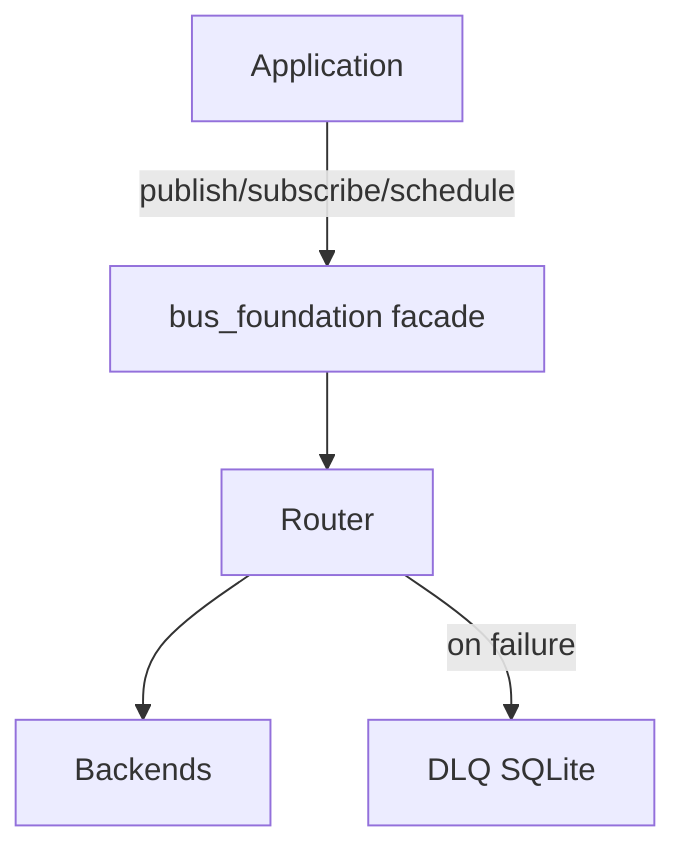

# bus-foundation — Architecture

> **Layer**: X 横切框架  
> **Role**: 共享事件/传输总线 — pub/sub/schedule/DLQ  
> **Stack**: Python 3.13+, uv, pydantic only runtime dep  
> **Health**: See local CI
> **SSOT**: 运行时健康、测试规模以本项目 CI 和 workspace governance SSOT 为准
>
> 系统全景参见：[`../../docs/PANORAMA.md`](../../docs/PANORAMA.md)

---

## 1. 内部架构



## 2. 入口

| Type | Entry | Port / Notes |
|:--|:--|:--|
| Library API | `from bus_foundation import publish, subscribe, schedule` |  |

## 3. 核心模块

| Module | Responsibility |
|:--|:--|
| `src/bus_foundation/__init__.py` | Facade + backend registry |
| `src/bus_foundation/envelope.py` | BusEnvelope wire format |
| `src/bus_foundation/router.py` | Backend dispatch + DLQ fallback |
| `src/bus_foundation/dlq.py` | SQLite dead-letter queue |
| `src/bus_foundation/backends/` | 10 backends: eventbus/asyncio/croniter/messagebus/sse/ws/realtime/persistent_bus/data_plane/control_plane |

## 4. 测试

```bash
cd projects/bus-foundation && uv run pytest -q
```
