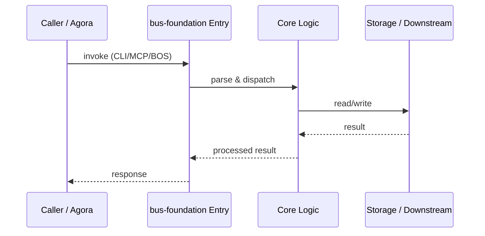

# bus-foundation — Call Chain

> 本文档描述 bus-foundation 内部最核心的一条调用链 / 数据流。
>
> 通用跨层调用链参见：[`docs/I0-AGORA-CALLCHAIN.md`](../docs/I0-AGORA-CALLCHAIN.md)

---

## 关键路径

1. 1. Caller imports `publish` / `subscribe` / `schedule`
2. 2. Facade selects backend from registry (default eventbus)
3. 3. `router.py` dispatches envelope to backend
4. 4. On failure, message routed to DLQ (`~/.runtime/bus_dlq.db`)
5. 5. Backends: eventbus, asyncio, croniter, messagebus, sse, ws, realtime, persistent_bus

## Sequence Diagram

